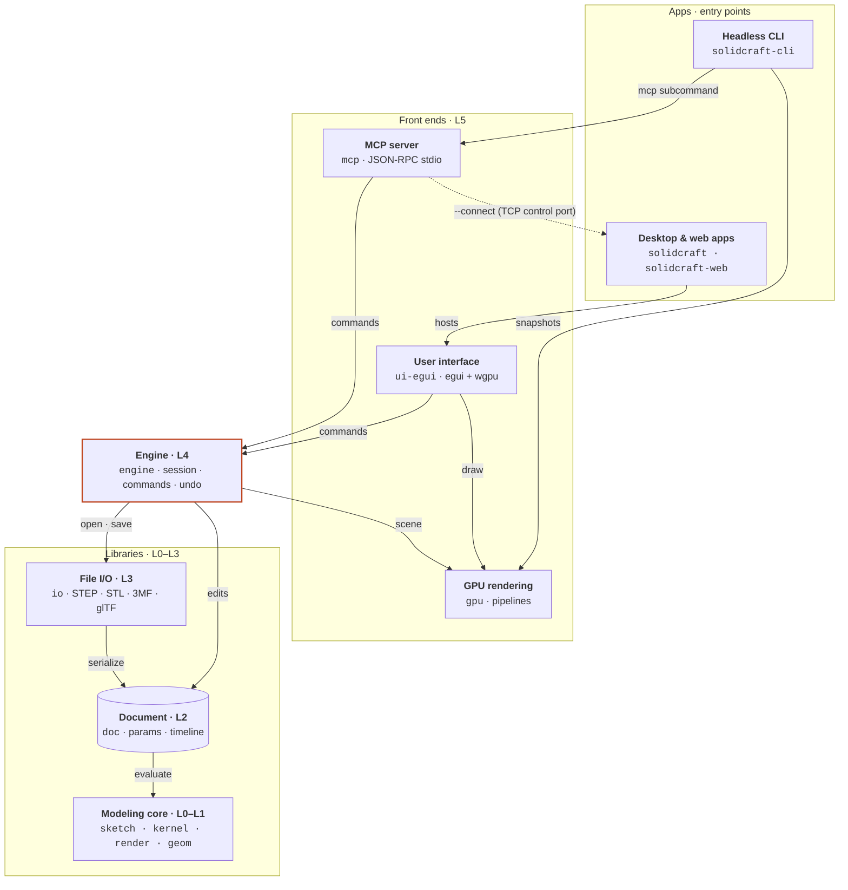

# Architecture

Every entry point drives one engine. Arrows show who calls whom at run time; layers follow the
[README](../README.md#architecture) (L0 `geom` up to L5 front ends).

| Node | Crates | Role |
|---|---|---|
| Desktop & web apps | `solidcraft`, `solidcraft-web` | Native and browser (WebGPU / WebGL2) shells around the egui UI |
| Headless CLI | `solidcraft-cli` | Command scripts, export, snapshots, and the `mcp` subcommand |
| User interface | `ui-egui` | The swappable desktop front end |
| GPU rendering | `gpu` | Viewport pipelines, offscreen captures, compute-shader tessellation |
| MCP server | `mcp` | Lets agents drive a headless session, or the running app over the [control protocol](control-protocol.md) |
| Engine | `engine` | The session and command registry: every action, from any front end, is a command |
| File I/O | `io` | Design files plus STL/OBJ/STEP/IGES/3MF/glTF, FreeCAD and Rhino import |
| Document | `doc` | Parameters, expressions, the feature timeline and its incremental evaluation |
| Modeling core | `sketch`, `kernel`, `render`, `geom` | Constraint solver, B-rep kernel boundary (truck), view math, geometry foundation |

Not drawn: `derive` (proc macros used by `doc`) and `space-mouse` / `3dx-client` (3D-mouse
input, desktop app only).
